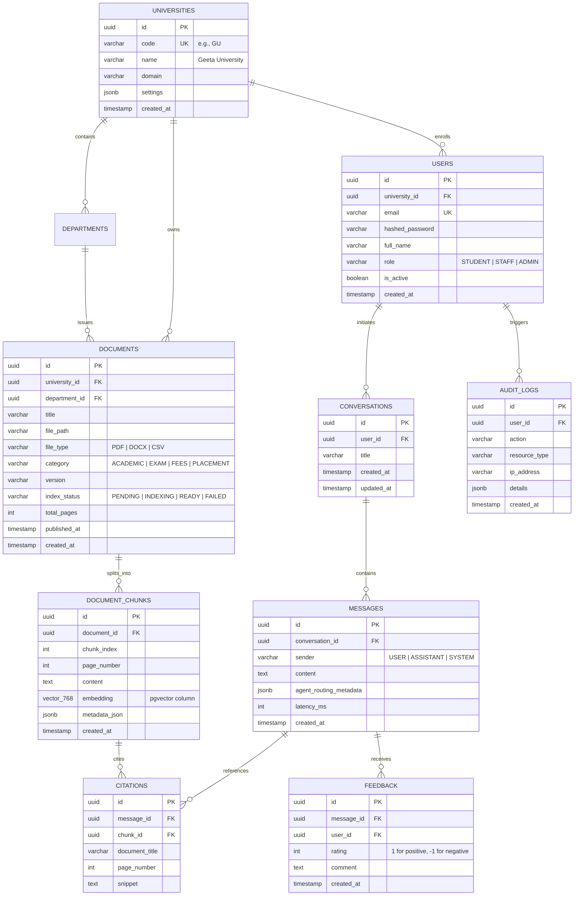

# Database Design & Entity Relationship Specifications
## CampusCopilot AI Platform

---

### 1. Architectural Strategy
CampusCopilot AI utilizes a PostgreSQL relational database with `pgvector` extension for dense embedding storage, maintaining strict referential integrity, tenant isolation, and auditability.

---

### 2. Entity Relationship Diagram (ERD)

---

### 3. Key Schema Design Decisions
1. **Unified Storage (`pgvector`):** Collocating tabular metadata with vector embeddings inside PostgreSQL eliminates dual-write consistency issues and reduces infrastructure overhead.
2. **Deterministic Chunks & Page Numbers:** Chunks explicitly preserve `page_number` and `document_id` foreign keys to ensure citations link to actual physical pages in official PDFs.
3. **Auditability & Observability:** Every interaction records `latency_ms`, agent classification paths, and user feedback to compute real-time product metrics.
