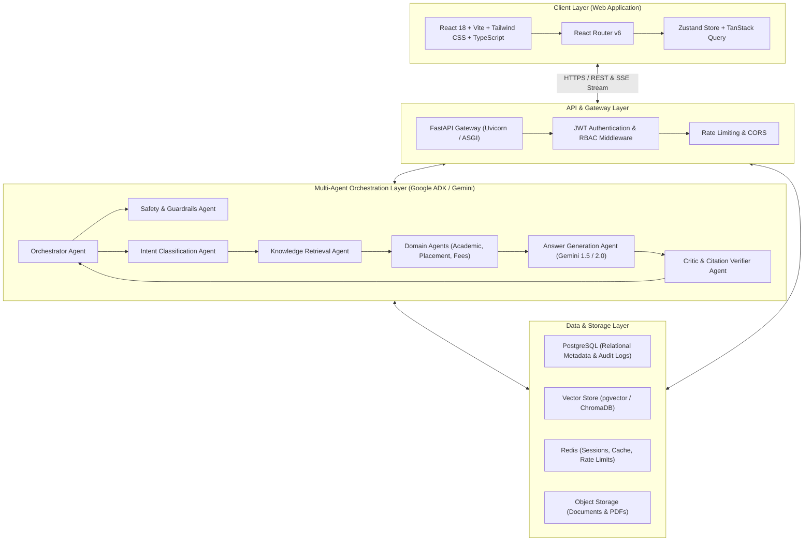
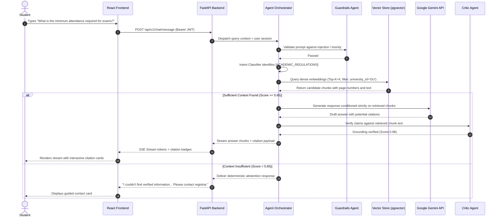
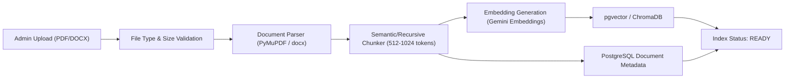

# System Architecture & Technical Design
## CampusCopilot AI Platform

---

### 1. High-Level Architecture
CampusCopilot AI follows a modern, decoupled cloud architecture designed for high availability, low latency, and deterministic factual accuracy.

---

### 2. End-to-End Query Execution Flow
The diagram below details how a student's prompt is processed from input to streaming cited response:

---

### 3. Document Ingestion Pipeline Flow

