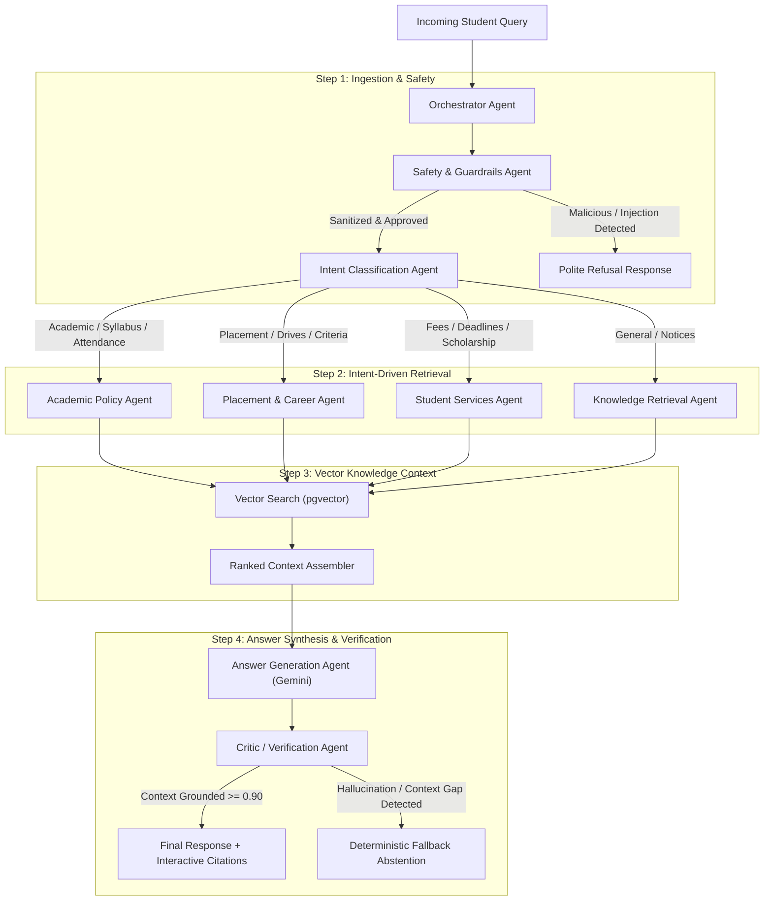

# Multi-Agent Architecture & Guardrails Specification
## CampusCopilot AI Platform

---

### 1. Agent Ecosystem Overview
CampusCopilot AI implements an orchestrated multi-agent workflow engineered with Google Gemini and the Google Agent Development Kit (ADK) pattern. Agents possess distinct, non-overlapping system prompts, specialized tools, and validation rules.

---

### 2. Agent Catalog & Definitions

| Agent Name | Primary Responsibility | Input Schema | Output Schema |
| :--- | :--- | :--- | :--- |
| **1. Orchestrator** | Coordinates multi-agent lifecycle, routes payload, handles exceptions. | User query, history, session token | Unified response object with citations |
| **2. Guardrails** | Detects prompt injections, jailbreaks, PII extraction, and off-topic abuse. | Raw user prompt | `{ is_safe: bool, reason: str }` |
| **3. Intent Classifier** | Categorizes university query into domain buckets. | Sanitized text | `{ category: Enum, confidence: float }` |
| **4. Retrieval Agent** | Executes semantic search, filters by university & department metadata. | `{ query: str, filters: dict, top_k: int }` | List of ranked chunk contexts with citations |
| **5. Domain Agents** | Injects domain-specific reasoning (e.g., fee installments vs. attendance waiver policies). | Query + Retrieved Chunks | Formatted domain context |
| **6. Answer Generator** | Generates plain-language, professional, empathetic response via Gemini. | Query + Verified Context | Markdown text with citation tags `[^doc_id_pX]` |
| **7. Critic Agent** | Cross-examines generated answer against source context snippets to verify claims. | Draft answer + Source context chunks | `{ is_grounded: bool, score: float, citations: list }` |

---

### 3. Strict Guardrails & Abstention Protocol

#### Rule 1: Zero External Knowledge for University Facts
When answering university-specific factual inquiries (e.g., dates, policies, fees), the Answer Generator is instructed with a temperature of $0.1$:
> *"You are CampusCopilot AI. Answer the user question SOLELY based on the provided authorized context. If the provided context does not contain enough evidence to answer conclusively, do NOT invent or estimate facts. Return the standard abstention directive."*

#### Rule 2: Deterministic Abstention Statement
Whenever the Critic Agent computes a groundedness score $<0.70$ or vector similarity drops below the acceptable boundary:
> *"I couldn't find verified information about this in the available university documents. Please contact the relevant university department or visit the official registrar office."*
