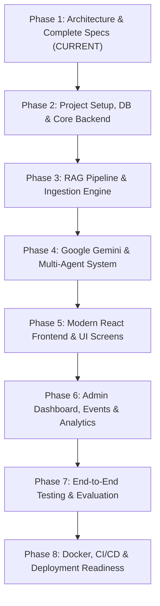

# Development Roadmap & Phase Execution Plan
## CampusCopilot AI Platform

---

### Milestone Breakdown

| Phase | Core Deliverables | Target Artifacts |
| :--- | :--- | :--- |
| **Phase 1** | Product architecture, PRD, SRS, ERD, Multi-Agent workflow, and UI screen inventory. | Complete `docs/` repository specifications. |
| **Phase 2** | FastAPI backend skeleton, Alembic migrations, PostgreSQL schemas, JWT auth & RBAC. | `backend/app/`, `backend/requirements.txt`, Docker Compose. |
| **Phase 3** | Document parser (PyMuPDF/docx), chunking algorithm, vector embeddings, vector store integration. | `backend/app/rag/`, `backend/app/document_processing/`. |
| **Phase 4** | Gemini API integration, Multi-Agent routing (Orchestrator, Intent Classifier, Domain, Critic, Guardrails). | `backend/app/agents/`, SSE streaming endpoints. |
| **Phase 5** | Vite + React + Tailwind frontend, responsive layout, full Chat interface with streaming & citation popovers. | `frontend/src/`. |
| **Phase 6** | Administrative document management, notice board, real-time analytics graphs (Recharts). | Admin routes & dashboards in frontend and backend. |
| **Phase 7** | Pytest suites for auth, RAG retrieval accuracy, Critic ground truth evaluation dataset, frontend unit tests. | `tests/` directory with automated runners. |
| **Phase 8** | Multi-stage Dockerfiles, docker-compose.yml, GitHub Actions CI pipelines, deployment guide. | `.github/workflows/`, Docker configurations. |
