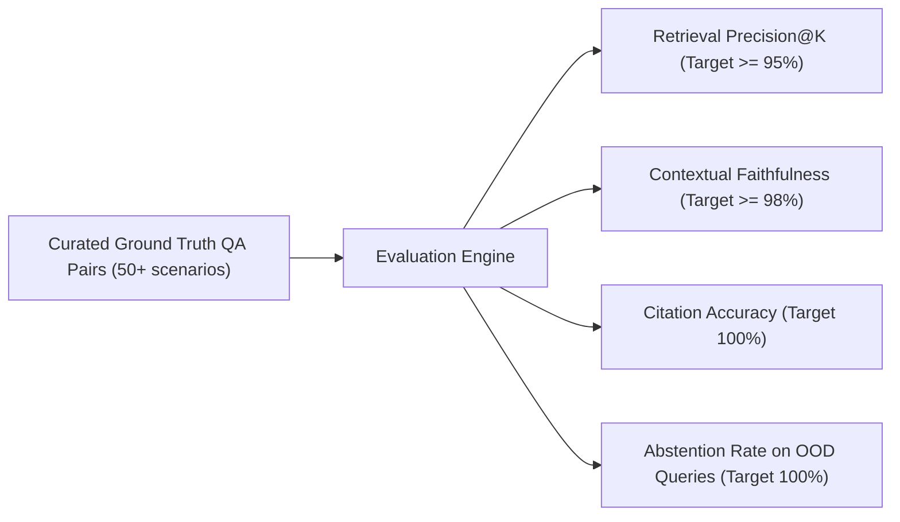

# Testing Strategy & AI Evaluation Framework
## CampusCopilot AI Platform

---

### 1. Dual Testing Architecture
CampusCopilot AI mandates two distinct validation regimens:
1. **Deterministic Software Testing:** Traditional unit, integration, and security checks covering APIs, database migrations, and authentication flows.
2. **Probabilistic AI & RAG Evaluation:** Empirical benchmarking of retrieval precision, contextual faithfulness, hallucination mitigation, and abstention compliance.

---

### 2. AI & RAG Evaluation Metrics

| Evaluation Metric | Definition | Threshold |
| :--- | :--- | :--- |
| **Retrieval Hit Rate (HR@4)** | Frequency at which the authoritative document chunk is present in Top-4 retrieved results. | $\ge 95\%$ |
| **Faithfulness Score** | Fraction of statements in generated response that can be mathematically derived from context. | $\ge 98\%$ |
| **Hallucination Rate** | Assertions containing unverified dates, fees, or policy clauses. | $< 1.0\%$ |
| **Abstention Reliability** | Correctly triggering the refusal template when queries relate to non-indexed domains. | $100\%$ |
| **Average First Token Latency** | Time between client request dispatch and receipt of first streamed token. | $< 1.2\text{ s}$ |

---

### 3. Evaluation Dataset Architecture
Located in `tests/eval_dataset.json`, each entry includes:
- `query`: The student question.
- `expected_domain`: `ACADEMIC` / `FEES` / `EXAM` / etc.
- `ground_truth_chunks`: List of golden chunk texts.
- `expected_answer`: Authoritative answer.
- `expected_citations`: Expected document name and page number.
- `is_answerable`: Boolean (false tests abstention capability).
